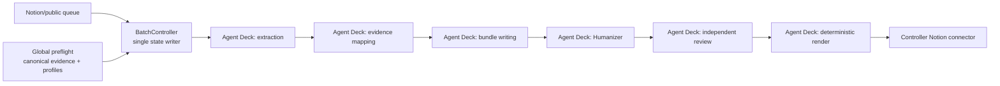

# Agent Skills and Orchestration Architecture

The application pipeline uses a flat, durable control plane. Skills define one
semantic operation; they do not form a tree of agents.

## Ownership

The controller owns the job DAG, concurrency, Agent Deck session lifecycle,
attempt numbers, retries, batch state, and timing ledgers. It resolves one
explicit private data root and performs shared preflight before model use.
Only it may use authenticated integrations.

Agent Deck is the default managed executor. A direct-process executor supports
the same task/result contracts for local automation. Provider-specific flags
are isolated in `orchestration.worker_command`: Agy uses one-shot `--print`,
all harnesses receive the data root explicitly, and unsupported model flags are
rejected before launch.

## Failure model

A missing or invalid result contract is a stage failure even if a session is
idle. Retryable failures create a fresh session and attempt directory for only
that stage while preserving validated upstream artifacts. Non-retryable
blockers become `needs_input`; profile maintenance is a separate explicit
workflow. Finalized ledgers are immutable.

## Data and security

Resolution order is explicit `--data-root`, `JAA_DATA_ROOT`, then user config;
there is no `./job-search` fallback. Repository overlap is rejected. Setup
persists the selected root in `~/.config/job-application-agents/config.json`,
and `/home/falluba/job-application-agents/.venv/bin/python /home/falluba/job-application-agents/scripts/audit_data_roots.py` detects or explicitly quarantines old
repository-local shadows.

The pipeline prepares reviewable drafts only. It never submits applications,
contacts employers, invokes auto-apply, or marks records `APPLIED`.
